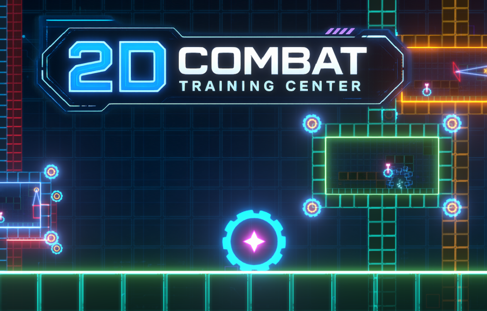
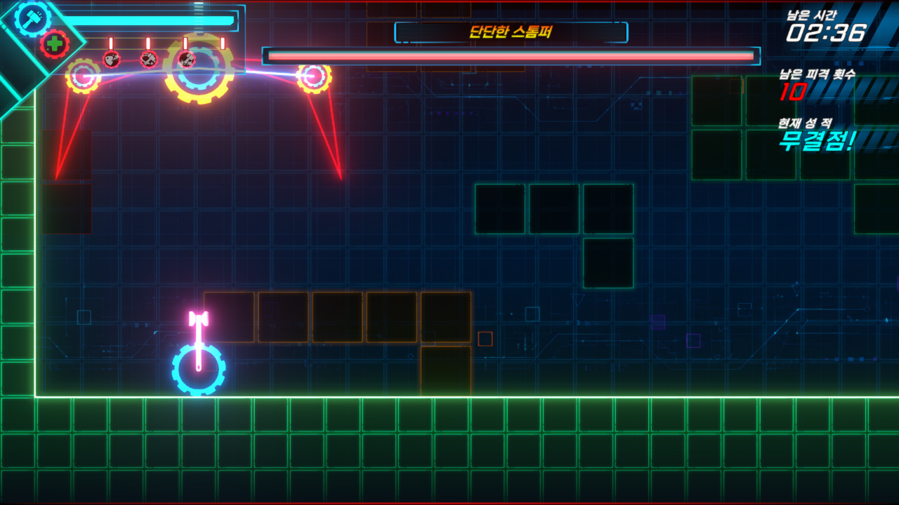
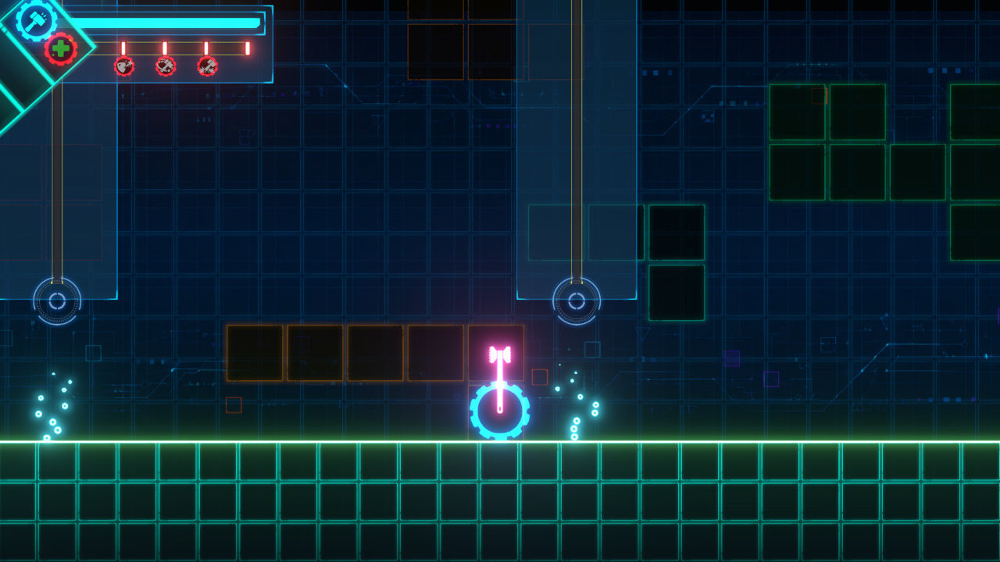
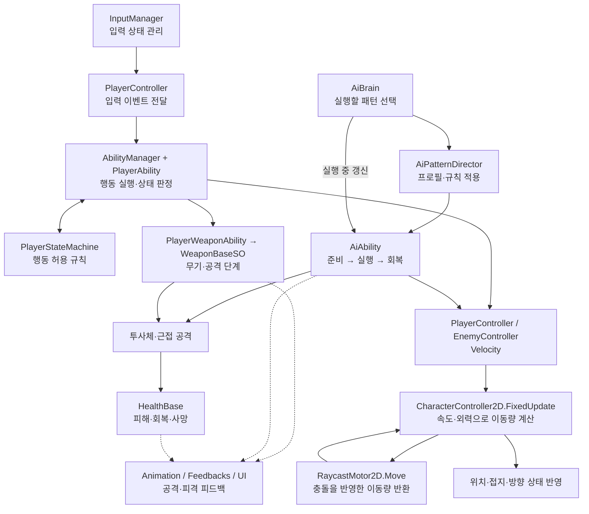
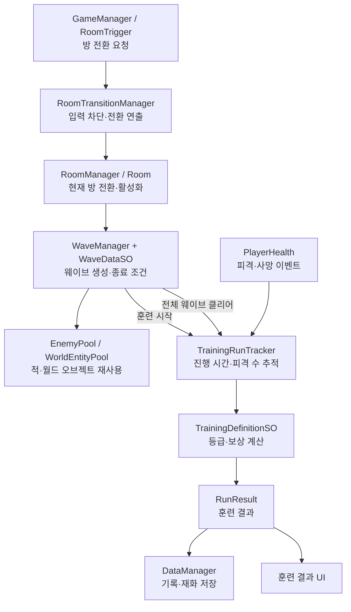

# 2D Combat Training Center

**공격을 읽고, 타이밍을 익히고, 다음 훈련에 도전하세요.**

이동·회피와 여러 무기를 조합해 보스 패턴과 웨이브에 대응하는 Unity 기반 2D 전투 트레이닝 게임입니다.

  
  
  
  

<strong><a href="https://capable-shade-0e8.notion.site/2D-Combat-Training-Center-401f11a67c9c81659388e84c5944d0a3">프로젝트·설계 문서 ↗</a></strong> &nbsp; · &nbsp; <a href="#features">주요 기능</a> &nbsp; · &nbsp; <a href="#design">핵심 설계</a> &nbsp; · &nbsp; <a href="#code-map">코드 탐색</a>

## 게임 소개

플레이어는 이동·점프·대시와 여러 무기를 조합해 훈련 웨이브에 도전합니다. 적의 준비 동작과 공격 범위를 읽고 대응하며, 훈련이 끝나면 **피격 횟수와 소요 시간에 따른 등급·보상**을 확인합니다.

**훈련 선택 → 웨이브 전투 → 결과 평가 → 기록 저장 → 다음 도전**

| 프로젝트 | 내용 |
| --- | --- |
| 형태 | 개발 중인 개인 Unity 2D 전투·훈련 프로젝트 |
| 기준 환경 | Unity **6000.2.9f1** · **C#** |
| 공개 내용 | 게임·개발 지원 스크립트 **196개**, 입력 생성 코드 포함 · 설계 구조도 · 대표 이미지·게임 캡처 |
| 상세 문서 | Notion에서 시스템 개요 → 기능별 상세 설계 → 관련 코드 순서로 탐색 |

## 주요 기능

<table>
  <tr>
    <td width="33%" valign="top"><strong>이동과 회피</strong>  이동·2단 점프·대시를 조합하고, 현재 상태에 맞는 행동을 실행합니다.</td>
    <td width="33%" valign="top"><strong>무기와 Gear</strong>  무기 선택, 콤보·카운터·투사체와 Gear를 전투 흐름에 연결합니다.</td>
    <td width="33%" valign="top"><strong>적과 보스 패턴</strong>  준비 동작과 공격 범위를 읽고 돌진·근접·레이저 등의 패턴에 대응합니다.</td>
  </tr>
  <tr>
    <td valign="top"><strong>웨이브와 훈련 평가</strong>  웨이브를 진행하고 시간·피격 수·클리어 여부를 등급과 보상으로 정리합니다.</td>
    <td valign="top"><strong>방 전환과 기록</strong>  훈련 진입·재도전·로비 복귀를 전환 연출로 연결하고 결과·재화를 저장합니다.</td>
    <td valign="top"><strong>전투 피드백</strong>  애니메이션·사운드·카메라·화면 효과와 HUD로 공격·피격 상태를 전달합니다.</td>
  </tr>
</table>

<strong>보스 전투 화면 더 보기</strong>

기존 개발 캡처로, 전투 화면과 HUD의 구성을 보여줍니다. 촬영일은 기록되어 있지 않습니다.

<strong>훈련 공간 화면 더 보기</strong>

기존 개발 캡처로, 훈련 공간과 HUD의 구성을 보여줍니다. 촬영일은 기록되어 있지 않습니다.

## 핵심 설계

### 01. 행동과 충돌 계산을 나눈 이동 구조

플레이어와 적의 행동 코드는 `Velocity`를 계산하고, `CharacterController2D.FixedUpdate`가 `RaycastMotor2D.Move`의 결과를 실제 위치·접지 상태에 반영합니다. 이동 정책과 충돌 계산의 책임을 구분합니다.

발사체는 같은 모터의 Collider 경로·겹침 질의로 틱 사이의 피격 누락을 보완합니다. 상대 진영 필터, 재사용 결과 목록과 물리 틱당 한 번의 Transform 동기화를 사용하며, **첫 명중 반환·관통·간격별 반복 피해**는 탄별 규칙으로 유지합니다.

→ [CharacterController2D](Scripts/Controllers/CharacterController2D.cs) · [RaycastMotor2D](Scripts/Controllers/RaycastMotor2D.cs) · [ProjectileBase](Scripts/Weapons/Projectiles/ProjectileBase.cs)

### 02. 선택 규칙과 패턴 실행을 분리한 전투 구조

`AiBrain`은 실행할 후보를 선택하고 `AiPatternDirector`는 프로필·규칙을 적용합니다. `AiAbility`는 **Windup → Execute → Recover** 단계에서 실제 패턴을 실행합니다. 거리·상태에 따른 선택과 돌진·레이저 등의 동작을 나눠 읽을 수 있습니다.

플레이어도 `AbilityManager`와 `PlayerStateMachine.CanPerform`으로 행동 가능 여부를 확인하고, `PlayerWeaponAbility`와 `WeaponBaseSO`로 무기·공격 단계를 연결합니다.

→ [AiBrain](Scripts/Abilities/Enemies/Core/AiBrain.cs) · [AiPatternDirector](Scripts/Abilities/Enemies/Core/AiPatternDirector.cs) · [AiAbility](Scripts/Abilities/Enemies/Core/AiAbility.cs)

**Constructor의 유도 미사일 패턴** — 기존 모터로 양쪽 벽의 X 중점과 중앙 바닥 높이를 찾고, 보스 기준 위치가 바닥 위 5인 중앙 목표로 이동합니다. 도착 후 준비 동작을 거쳐 플레이어 반대쪽 발사구에서 두 발을 0.35초 간격으로 쏩니다. 두 번째 발사로부터 1초 뒤 다른 발사구에서 같은 간격으로 두 발을 쏘며, 발사 시각에 맞는 반동·흰 연기·로켓 발사음을 Feedback으로 연결합니다.

각 미사일은 좌우 위쪽 45도 대각선으로 0.7초 동안 사출된 뒤 현재 플레이어를 추적합니다. 속도 6→3의 감속과 3→14의 재가속, 초당 180도의 선회 한도와 각가속도 제한으로 움직임을 잇습니다. 접근 뒤 지나치면 보유 각속도를 1.8초 동안 줄이며 관성으로 이탈합니다. 이동·지형 충돌·타격·폭발 범위 질의는 기존 RaycastMotor2D 경로를 사용합니다.

폭발 반경 1.5에 범위 피해 12를 적용하며 직격 대상과 여러 Collider의 중복 피해를 제외합니다. 폭발 Trail은 분리해 자연 소멸시키고 다음 발사에는 빈 Renderer를 사용합니다. StomperDestroyEffect를 참고한 짧은 지속 폭발과 Platform에 부딪히는 파편은 시각 효과로 재생하며, 강제 반환·Disable 취소는 폭발 피해를 만들지 않습니다. 패턴 중단·종료 때는 관절·Facing·LockFacing과 중력·외력 상태를 복원합니다.

### 03. 훈련 설정·진행 상태·결과 저장의 구분

`WaveDataSO`는 웨이브 설정을, `TrainingRunTracker`는 시간·피격·사망 등의 진행 기록을 담당합니다. `TrainingDefinitionSO`로 등급·보상을 계산한 뒤 `DataManager`가 결과와 재화를 반영합니다. 적과 월드 오브젝트는 Pool을 통해 대여·반환합니다.

→ [WaveManager](Scripts/Waves/WaveManager.cs) · [TrainingRunTracker](Scripts/Training/TrainingRunTracker.cs) · [DataManager](Scripts/Persistence/DataManager.cs)

<strong>전투·이동 전체 구조도 펼치기</strong>

화살표는 주요 데이터 흐름과 호출 관계를 나타냅니다.

플레이어는 입력 이벤트를 Ability에 전달하고, `AbilityManager`가 현재 행동을 정리합니다. 각 Ability는 `PlayerStateMachine.CanPerform`을 통해 행동 가능 여부를 확인합니다. 적은 `AiBrain`이 실행 가능한 후보를 선택하고, `AiPatternDirector`가 프로필과 규칙을 적용합니다. 강제 지정한 적 행동은 후보 선택 경로를 건너뜁니다.

플레이어와 적의 일반적인 속도 기반 이동은 `CharacterController2D`의 공통 경로를 사용합니다. `RaycastMotor2D`가 충돌을 계산한 이동량을 반환하면 컨트롤러가 위치와 충돌 상태를 반영합니다.

발사체는 `MovingEntityBase → RaycastMotor2D.Move`로 이동하고, `ProjectileBase`가 모터의 Collider 경로·겹침 질의로 틱 사이의 피격 누락을 보완합니다. 상대 진영 레이어와 재사용 결과 목록을 사용하며 캐릭터 이동 뒤 물리 틱당 한 번 Transform을 동기화합니다. 일반 탄의 첫 명중 반환, 관통 탄의 대상별 한 번 피해, Hammer의 간격별 반복 피해는 각각의 명중 규칙으로 유지합니다. 지뢰는 기존 설치·기폭 수명을 사용합니다.

<strong>훈련 진행·결과 처리 구조도 펼치기</strong>

`WaveManager`가 훈련 시작과 웨이브 완료를 알리고, `TrainingRunTracker`가 피격·사망 이벤트와 진행 시간을 기록합니다. 클리어 여부에 따라 등급과 보상을 정한 뒤 `DataManager`에 결과를 반영합니다. 방 전환과 재도전은 별도의 전환 요청·연출 구조를 사용합니다.

## 코드 탐색

관심 있는 시스템의 진입점부터 살펴볼 수 있습니다. 각 스크립트의 역할·연결 관계와 상세 설명은 [Notion 설계 문서](https://capable-shade-0e8.notion.site/2D-Combat-Training-Center-401f11a67c9c81659388e84c5944d0a3)의 **전체 스크립트 찾아보기**에 연결되어 있습니다.

| 관심 영역 | 시작할 코드 | 살펴볼 내용 |
| --- | --- | --- |
| 캐릭터 이동 | [CharacterController2D](Scripts/Controllers/CharacterController2D.cs) · [RaycastMotor2D](Scripts/Controllers/RaycastMotor2D.cs) | 속도·외력·접지와 충돌 결과 처리 |
| 입력과 행동 | [PlayerController](Scripts/Controllers/PlayerController.cs) · [AbilityManager](Scripts/Abilities/Player/AbilityManager.cs) · [PlayerStateMachine](Scripts/Abilities/Player/PlayerStateMachine.cs) | 입력 이벤트, 행동 우선순위, 상태별 실행 제한 |
| 무기와 전투 | [PlayerWeaponAbility](Scripts/Abilities/Player/PlayerWeaponAbility.cs) · [WeaponBaseSO](Scripts/Weapons/Definitions/WeaponBaseSO.cs) · [Weapons](Scripts/Weapons/Definitions) | 무기 선택, 공격 단계, 콤보·카운터·투사체 |
| 발사체 판정 | [ProjectileBase](Scripts/Weapons/Projectiles/ProjectileBase.cs) · [Projectiles](Scripts/Weapons/Projectiles) | 이동 경로 검사, 관통·반복 피해, 풀 반환 |
| 적 행동 | [AiBrain](Scripts/Abilities/Enemies/Core/AiBrain.cs) · [AiPatternDirector](Scripts/Abilities/Enemies/Core/AiPatternDirector.cs) · [AiAbility](Scripts/Abilities/Enemies/Core/AiAbility.cs) | 행동 선택, 프로필·규칙, 단계별 패턴 실행 |
| Constructor 유도 미사일 | [ConstructorHomingMissileAbility](Scripts/Abilities/Enemies/Patterns/Bosses/Constructor/ConstructorHomingMissileAbility.cs) · [ConstructorHomingMissileDataSO](Scripts/Abilities/Enemies/Data/Bosses/Constructor/ConstructorHomingMissileDataSO.cs) · [ConstructorHomingMissile](Scripts/Weapons/Projectiles/ConstructorHomingMissile.cs) | 중앙 이동 뒤 플레이어 반대쪽 발사구부터 두 발씩 순차 발사, 제한된 유도와 가속, 기존 판정·Feedback·풀 수명 |
| 웨이브 | [WaveManager](Scripts/Waves/WaveManager.cs) · [WaveDataSO](Scripts/Waves/Data/WaveDataSO.cs) · [Wave](Scripts/Waves) | 스폰 설정, 클리어 조건, 적·월드 오브젝트 풀링 |
| 훈련 평가·저장 | [TrainingRunTracker](Scripts/Training/TrainingRunTracker.cs) · [TrainingDefinitionSO](Scripts/Training/TrainingDefinitionSO.cs) · [DataManager](Scripts/Persistence/DataManager.cs) | 결과 수집, 등급·보상, JSON 저장 |
| 방 전환 | [RoomTransitionManager](Scripts/Rooms/RoomTransitionManager.cs) · [Rooms](Scripts/Rooms) | 전환 요청, 컨텍스트와 연출 분리 |
| 훈련 선택·홀로그램 | [TrainingMenuController](Scripts/UI/Menus/TrainingMenuController.cs) · [TrainingMenuMechanism](Scripts/UI/Effects/TrainingMenuMechanism.cs) · [TrainingHologramGraphic](Scripts/UI/Effects/TrainingHologramGraphic.cs) | 빔 투사와 화면 열기·닫기, 목록·상세 좌우 전환, 기어·케이블 표시 수명과 UI Mesh |
| 표현 | [Feedbacks](Scripts/Feedbacks) · [Animation](Scripts/Animation) · [UI](Scripts/UI) | 사운드·카메라·화면 효과와 상태 표시 |
| 배경 배치 도구 | [LobbyBackdropLayoutEditor](Scripts/Editor/LobbyBackdropLayoutEditor.cs) · [LobbyBackdropLayoutBaker](Scripts/Editor/LobbyBackdropLayoutBaker.cs) · [LobbyBackdropParallax](Scripts/World/LobbyBackdropParallax.cs) · [LobbyCableScroll](Scripts/World/LobbyCableScroll.cs) · [LobbyBackdropDepth](Scripts/World/LobbyBackdropDepth.cs) · [LobbyBackdropBatchRenderer](Scripts/World/LobbyBackdropBatchRenderer.cs) · [LobbyBackdropGearInstancing](Scripts/World/LobbyBackdropGearInstancing.cs) · [LobbyObservationWindow](Scripts/World/LobbyObservationWindow.cs) | 후경·Furniture 위치 편집, 연결점 기반 장식 동선 갱신, 후경 시차·케이블 UV 흐름·깊이별 명암 합성·장식 형상 결합·반복 기어 GPU instancing·통창 불투명도 조절 |
| 훈련실 배경 연출 | [TrainingFabricationFlow](Scripts/World/TrainingFabricationFlow.cs) | 공장형 모형의 마스크 생성, 관절 팔·컨베이어·집게 이송과 복귀 제어 |

## 환경과 공개 범위

**Unity 6000.2.9f1**을 기준으로 Input System, Cinemachine, Universal Render Pipeline, DOTween, TextMesh Pro를 참조합니다.

`Scripts/`는 게임 코드의 폴더 구성을 유지합니다. `Scripts/Input/Generated/PlayerInputActions.cs`는 Unity Input System이 프로젝트 입력 설정에서 생성한 코드입니다.

이 저장소는 **코드와 설계를 살펴보기 위한 공개 스크립트 저장소**입니다. 실행에 필요한 Scene·Prefab·ScriptableObject 인스턴스·외부 플러그인과 원본 게임 에셋은 전체 Unity 프로젝트에서 관리합니다. `Images/`에는 README 대표 이미지와 소개용으로 선별한 게임 캡처만 담았습니다.

이동·충돌 구현의 참고 출처는 [RaycastMotor2D.cs](Scripts/Controllers/RaycastMotor2D.cs)의 주석에 기록되어 있습니다.

---

  <strong>게임 화면에서 시작해, 설계를 읽고, 코드로 확인할 수 있습니다.</strong> 
  <a href="https://capable-shade-0e8.notion.site/2D-Combat-Training-Center-401f11a67c9c81659388e84c5944d0a3">프로젝트·설계 문서</a>
  &nbsp; · &nbsp;
  <a href="#code-map">코드 탐색으로 돌아가기</a>

