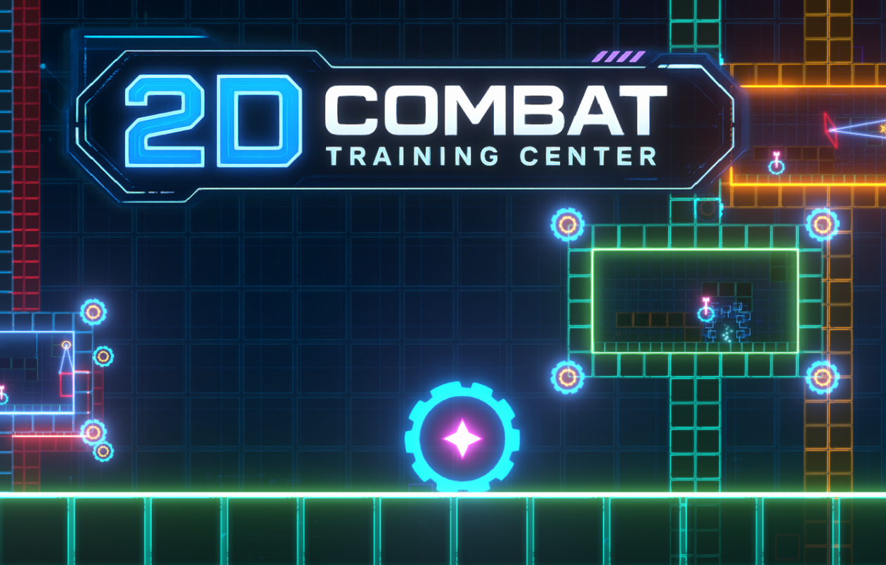
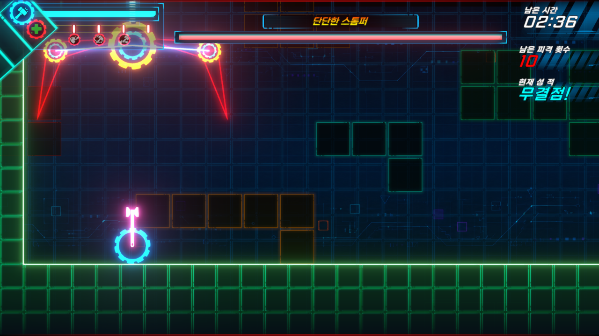
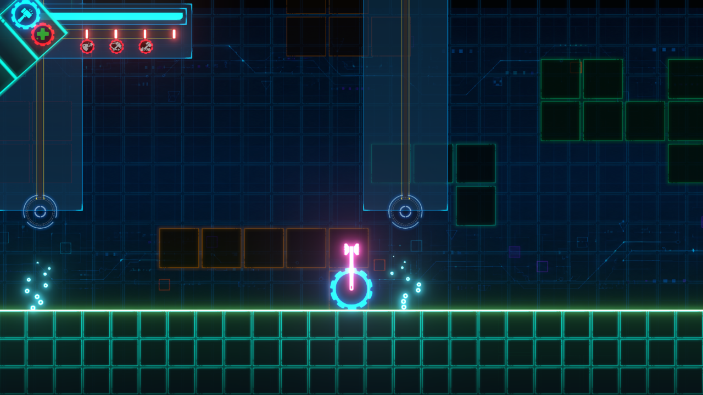
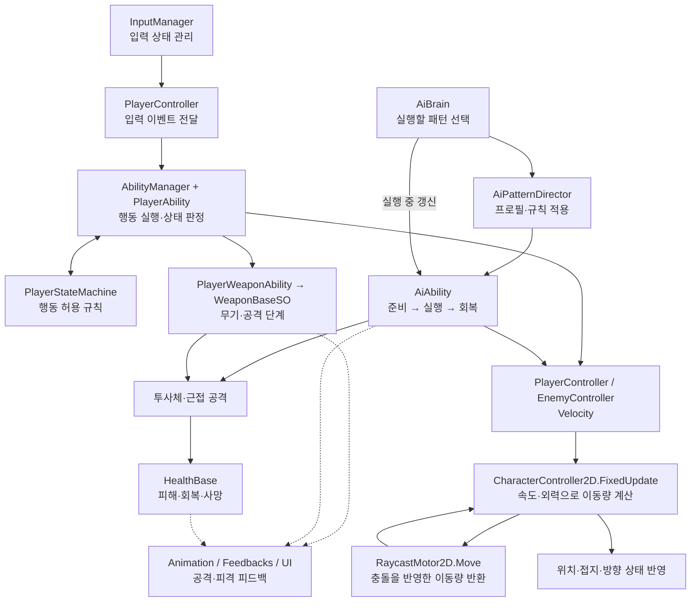
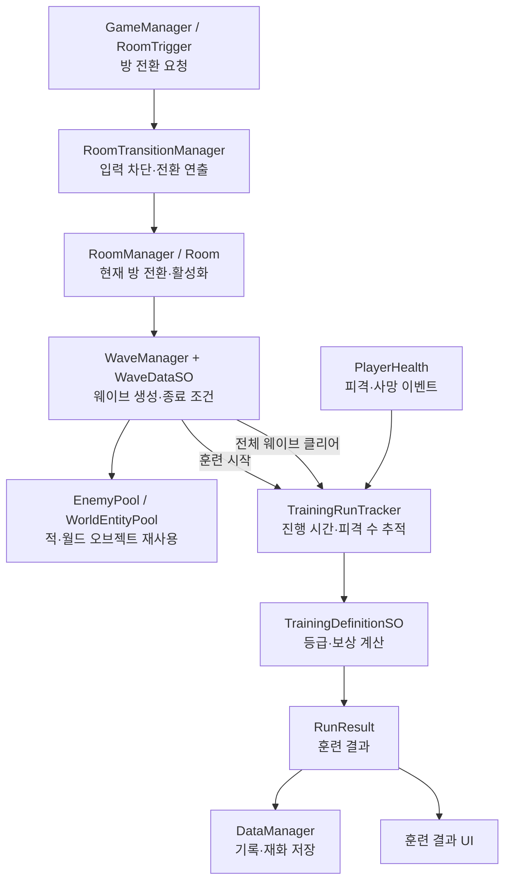

# 2D Combat Training Center

**공격을 읽고, 타이밍을 익히고, 다음 훈련에 도전하세요.**

이동·회피와 여러 무기를 조합해 보스 패턴과 웨이브에 대응하는 Unity 기반 2D 전투 트레이닝 게임입니다.

  
  
  
  

<strong><a href="https://capable-shade-0e8.notion.site/2D-Combat-Training-Center-401f11a67c9c81659388e84c5944d0a3">프로젝트·설계 문서 ↗</a></strong> &nbsp; · &nbsp; <a href="#features">주요 기능</a> &nbsp; · &nbsp; <a href="#design">핵심 설계</a> &nbsp; · &nbsp; <a href="#code-map">코드 탐색</a> &nbsp; · &nbsp; <a href="#ai-collaboration">AI 협업 방식</a>

## 게임 소개

플레이어는 이동·점프·대시와 여러 무기를 조합해 훈련 웨이브에 도전합니다. 적의 준비 동작과 공격 범위를 읽고 대응하며, 훈련이 끝나면 **피격 횟수와 소요 시간에 따른 등급·보상**을 확인합니다.

**훈련 선택 → 웨이브 전투 → 결과 평가 → 기록 저장 → 다음 도전**

| 프로젝트 | 내용 |
| --- | --- |
| 형태 | 개발 중인 개인 Unity 2D 전투·훈련 프로젝트 |
| 기준 환경 | Unity **6000.3.28f1** · **C#** |
| 공개 내용 | 게임·개발 지원 스크립트 **267개**, 입력 생성 코드 포함 · 설계 구조도 · 대표 이미지·게임 캡처 |
| 상세 문서 | Notion에서 시스템 개요 → 기능별 상세 설계 → 관련 코드 순서로 탐색 |

## 주요 기능

<table>
  <tr>
    <td width="33%" valign="top"><strong>이동과 회피</strong>  이동·2단 점프·대시를 조합하고, 현재 상태에 맞는 행동을 실행합니다.</td>
    <td width="33%" valign="top"><strong>무기와 Gear</strong>  무기 선택, 콤보·카운터·투사체와 Gear를 전투 흐름에 연결합니다.</td>
    <td width="33%" valign="top"><strong>적과 보스 패턴</strong>  준비 동작과 공격 범위를 읽고 돌진·근접·레이저 등의 패턴에 대응합니다.</td>
  </tr>
  <tr>
    <td valign="top"><strong>웨이브와 훈련 평가</strong>  웨이브를 진행하고 시간·피격 수·클리어 여부를 등급과 보상으로 정리합니다.</td>
    <td valign="top"><strong>방 전환과 기록</strong>  훈련 진입·재도전·로비 복귀를 전환 연출로 연결하고 결과·재화를 저장합니다.</td>
    <td valign="top"><strong>전투 피드백</strong>  애니메이션·사운드·카메라·화면 효과와 HUD로 공격·피격 상태를 전달합니다.</td>
  </tr>
</table>

Lobby의 손목 단말기 UI 시안은 홈에서 저장된 수료 비율·Gold를 보여 주고, 훈련 목표·적 도감·장비 교본·수신함을 통해 다음 도전에 필요한 정보를 모읍니다.

자율훈련장에서는 회복하는 Dummy를 자유롭게 타격하거나, 3초 준비 뒤 10초 전투 분석으로 무기·스킬별 피해와 DPS·기여도를 비교할 수 있습니다. 표적 수와 쉴드를 조절해 다음 훈련에 앞서 공격 조합을 연습합니다.

<strong>보스 전투 화면 더 보기</strong>

기존 개발 캡처로, 전투 화면과 HUD의 구성을 보여줍니다. 촬영일은 기록되어 있지 않습니다.

<strong>훈련 공간 화면 더 보기</strong>

기존 개발 캡처로, 훈련 공간과 HUD의 구성을 보여줍니다. 촬영일은 기록되어 있지 않습니다.

## 핵심 설계

### 01. 행동과 충돌 계산을 나눈 이동 구조

플레이어와 적의 행동 코드는 `Velocity`를 계산하고, `CharacterController2D.FixedUpdate`가 `RaycastMotor2D.Move`의 결과를 실제 위치·접지 상태에 반영합니다. 이동 정책과 충돌 계산의 책임을 구분합니다.

발사체는 같은 모터의 Collider 경로·겹침 질의로 틱 사이의 피격 누락을 보완합니다. 상대 진영 필터, 재사용 결과 목록과 물리 틱당 한 번의 Transform 동기화를 사용하며, **첫 명중 반환·관통·간격별 반복 피해**는 탄별 규칙으로 유지합니다.

→ [CharacterController2D](Scripts/Controllers/CharacterController2D.cs) · [RaycastMotor2D](Scripts/Controllers/RaycastMotor2D.cs) · [ProjectileBase](Scripts/Weapons/Projectiles/ProjectileBase.cs)

### 02. 선택 규칙과 패턴 실행을 분리한 전투 구조

`AiBrain`은 실행할 후보를 선택하고 `AiPatternDirector`는 프로필·규칙을 적용합니다. `AiAbility`는 **Windup → Execute → Recover** 단계에서 실제 패턴을 실행합니다. 거리·상태에 따른 선택과 돌진·레이저 등의 동작을 나눠 읽을 수 있습니다.

플레이어도 `AbilityManager`와 `PlayerStateMachine.CanPerform`으로 행동 가능 여부를 확인하고, `PlayerWeaponAbility`와 `WeaponBaseSO`로 무기·공격 단계를 연결합니다.

→ [AiBrain](Scripts/Abilities/Enemies/Core/AiBrain.cs) · [AiPatternDirector](Scripts/Abilities/Enemies/Core/AiPatternDirector.cs) · [AiAbility](Scripts/Abilities/Enemies/Core/AiAbility.cs)

Constructor의 동작과 설정은 [보스 패턴 상세 문서](https://capable-shade-0e8.notion.site/401f11a67c9c81c7b841cab7d9752dd4)에서 확인할 수 있습니다.

### 03. 훈련 설정·진행 상태·결과 저장의 구분

`WaveDataSO`는 웨이브 설정을, `TrainingRunTracker`는 시간·피격·사망 등의 진행 기록을 담당합니다. `TrainingDefinitionSO`로 등급·보상을 계산한 뒤 `DataManager`가 결과와 재화를 반영합니다. 적과 월드 오브젝트는 Pool을 통해 대여·반환합니다.

→ [WaveManager](Scripts/Waves/WaveManager.cs) · [TrainingRunTracker](Scripts/Training/TrainingRunTracker.cs) · [DataManager](Scripts/Persistence/DataManager.cs)

<strong>전투·이동 전체 구조도 펼치기</strong>

화살표는 주요 데이터 흐름과 호출 관계를 나타냅니다.

플레이어는 입력 이벤트를 Ability에 전달하고, `AbilityManager`가 현재 행동을 정리합니다. 각 Ability는 `PlayerStateMachine.CanPerform`을 통해 행동 가능 여부를 확인합니다. 적은 `AiBrain`이 실행 가능한 후보를 선택하고, `AiPatternDirector`가 프로필과 규칙을 적용합니다. 강제 지정한 적 행동은 후보 선택 경로를 건너뜁니다. 순찰처럼 시간으로 끝나지 않는 패턴은 실행 중에 자리를 넘길 수 있다고 알리고, `AiBrain`은 매 프레임 같은 규칙으로 다음 패턴을 확인해 준비되면 바로 전환합니다.

플레이어와 적의 일반적인 속도 기반 이동은 `CharacterController2D`의 공통 경로를 사용합니다. `RaycastMotor2D`가 충돌을 계산한 이동량을 반환하면 컨트롤러가 위치와 충돌 상태를 반영합니다. 정사각형 적(Jumper)의 구르기 순찰도 같은 경로를 씁니다. 물리 단계마다 아래 모서리를 축으로 넘어간 각도에서 다음 중심 위치를 계산해 `Velocity`로 넘기고, 외형은 실제 이동 거리에서 각도를 거꾸로 구해 돌리므로 축 모서리가 바닥에서 미끄러지지 않습니다.

발사체는 `MovingEntityBase → RaycastMotor2D.Move`로 이동하고, `ProjectileBase`가 모터의 Collider 경로·겹침 질의로 틱 사이의 피격 누락을 보완합니다. 상대 진영 레이어와 재사용 결과 목록을 사용하며 캐릭터 이동 뒤 물리 틱당 한 번 Transform을 동기화합니다. 일반 탄의 첫 명중 반환, 관통 탄의 대상별 한 번 피해, Hammer의 간격별 반복 피해는 각각의 명중 규칙으로 유지합니다. 지뢰는 기존 설치·기폭 수명을 사용합니다.

<strong>훈련 진행·결과 처리 구조도 펼치기</strong>

`WaveManager`가 훈련 시작과 웨이브 완료를 알리고, `TrainingRunTracker`가 피격·사망 이벤트와 진행 시간을 기록합니다. 클리어 여부에 따라 등급과 보상을 정한 뒤 `DataManager`에 결과를 반영합니다. 방 전환과 재도전은 별도의 전환 요청·연출 구조를 사용합니다.

타이틀 Intro를 재생한 직후에는 약 3초의 약한 노이즈를 거쳐 `NightmareIntroSequence`가 FinalRoom의 빈 악몽 구역으로 연결합니다. 왼쪽 안개와 URP Volumetric 가로등 빛이 오른쪽 이동을 유도하며, 흰 바닥선 아래에는 실제 월드 화면이 흐릿하게 반사됩니다. 넓은 간격의 가로등 세 개를 지나면 거울 배경과 가로등이 함께 파괴되고 입구가 막힙니다. 저장된 Lobby 설비 배치를 유지한 멈춘 공장이 드러난 뒤 기존 Nightmare Wave가 시작됩니다. 실제 외벽 셀은 떨어졌다가 복구되며 틈으로 약한 빛이 샙니다. 이 전투는 보스 체력을 1 이상 유지하고 훈련 기록을 시작하지 않습니다. 패배 즉시 기존 SFX를 정리하고 이명·블러를 재생한 뒤 `NightmareDefeatTerminal` 확인 후 TutorialWave의 방에 이동합니다. Intro를 본 출발에서는 타이틀 BGM을 끊지 않고 음량과 고음을 줄여 멀리서 들리게 잇고, 보스 전주가 시작되면 전용 BGM으로 바뀝니다.

## 코드 탐색

관심 있는 시스템의 진입점부터 살펴볼 수 있습니다. 각 스크립트의 역할·연결 관계와 상세 설명은 [Notion 설계 문서](https://capable-shade-0e8.notion.site/2D-Combat-Training-Center-401f11a67c9c81659388e84c5944d0a3)의 **전체 스크립트 찾아보기**에 연결되어 있습니다.

| 관심 영역 | 시작할 코드 | 살펴볼 내용 |
| --- | --- | --- |
| 캐릭터 이동 | [CharacterController2D](Scripts/Controllers/CharacterController2D.cs) · [RaycastMotor2D](Scripts/Controllers/RaycastMotor2D.cs) | 속도·외력·접지와 충돌 결과 처리 |
| 입력과 행동 | [PlayerController](Scripts/Controllers/PlayerController.cs) · [AbilityManager](Scripts/Abilities/Player/AbilityManager.cs) · [PlayerStateMachine](Scripts/Abilities/Player/PlayerStateMachine.cs) | 입력 이벤트, 행동 우선순위, 상태별 실행 제한 |
| 무기와 전투 | [PlayerWeaponAbility](Scripts/Abilities/Player/PlayerWeaponAbility.cs) · [WeaponBaseSO](Scripts/Weapons/Definitions/WeaponBaseSO.cs) · [Weapons](Scripts/Weapons/Definitions) | 무기 선택, 공격 단계, 콤보·카운터·투사체 |
| 발사체 판정 | [ProjectileBase](Scripts/Weapons/Projectiles/ProjectileBase.cs) · [Projectiles](Scripts/Weapons/Projectiles) | 이동 경로 검사, 관통·반복 피해, 풀 반환 |
| 적 행동 | [AiBrain](Scripts/Abilities/Enemies/Core/AiBrain.cs) · [AiPatternDirector](Scripts/Abilities/Enemies/Core/AiPatternDirector.cs) · [AiAbility](Scripts/Abilities/Enemies/Core/AiAbility.cs) | 행동 선택, 프로필·규칙, 단계별 패턴 실행, 실행 중 패턴의 자리 넘김 |
| 순찰·돌진 적(Roller) | [GroundPatrolAbility](Scripts/Abilities/Enemies/Patterns/GroundPatrolAbility.cs) · [BurstChargeAbility](Scripts/Abilities/Enemies/Patterns/BurstChargeAbility.cs) · [PlayerDetectionSwapRuleSO](Scripts/Abilities/Enemies/Selection/Rules/PlayerDetectionSwapRuleSO.cs) · [EnemyRollVisual](Scripts/Abilities/Enemies/Support/EnemyRollVisual.cs) | 벽에 막히거나 발판 끝에 닿으면(모터의 진행 방향 발밑 질의) 돌아서는 바닥 순찰, 시야 안 플레이어 감지 시 순찰에서 돌진으로 전환, 공회전 준비 뒤 플레이어 대시 속도 비율로 돌진하고 남은 제동 거리까지 계산해 목표 거리에서 멈춤, 돌진 뒤 플레이어 쪽 순찰, 이동 거리에 맞춘 바퀴 회전 |
| 구르기 순찰·점프 적(Jumper) | [TumblePatrolAbility](Scripts/Abilities/Enemies/Patterns/TumblePatrolAbility.cs) · [TumblePatrolDataSO](Scripts/Abilities/Enemies/Data/TumblePatrolDataSO.cs) · [EnemyTumbleVisual](Scripts/Abilities/Enemies/Support/EnemyTumbleVisual.cs) · [ParabolicDashAbility](Scripts/Abilities/Enemies/Patterns/ParabolicDashAbility.cs) · [AnimationFeedbackReceiver](Scripts/Animation/AnimationFeedbackReceiver.cs) | 정사각형이 아래 모서리를 축으로 한 면씩 넘어가는 순찰(들어 올린 뒤 모서리 축 중력 회전으로 떨어지고, 각도에서 계산한 위치로 이동해 축 모서리 고정), 한 칸이 남지 않은 벽 앞에서 기울었다 돌아섬, 시야 안 플레이어 감지 시 포물선 점프, 점프 뒤 플레이어 쪽 순찰, 준비 Clip 이벤트로 단계마다 달아오르는 색·불씨·차지 소리 |
| 군집 비행 적(Swarmer) | [FlyingPatrolAbility](Scripts/Abilities/Enemies/Patterns/FlyingPatrolAbility.cs) · [FlyingChaseAbility](Scripts/Abilities/Enemies/Patterns/FlyingChaseAbility.cs) · [FlyingAbility](Scripts/Abilities/Enemies/Patterns/FlyingAbility.cs) · [EnemyFlock](Scripts/Abilities/Enemies/Support/EnemyFlock.cs) · [EnemyFlightSound](Scripts/Abilities/Enemies/Support/EnemyFlightSound.cs) | 플레이어 옆 위의 유지 지점에서 난수 흔들림으로 맴돌다 다가가는 패턴 반복, 감속 도착(Arrival)과 즉시 더하는 분리(Separation)로 겹침 방지, 무리 중심 구성원을 둘러싸는 고리 대형과 무리 단위 좌우 전환, 카메라에 가까운 4마리까지만 들리고 순위마다 줄어드는 비행 반복음 |
| 비행 포격 적(Drone) | [FlyingShootAbility](Scripts/Abilities/Enemies/Patterns/FlyingShootAbility.cs) · [FlyingShootDataSO](Scripts/Abilities/Enemies/Data/FlyingShootDataSO.cs) · [FlyingPatrolAbility](Scripts/Abilities/Enemies/Patterns/FlyingPatrolAbility.cs) · [DroneEnemyBullet](Scripts/Weapons/Projectiles/DroneEnemyBullet.cs) · [EnemyFlightSound](Scripts/Abilities/Enemies/Support/EnemyFlightSound.cs) | 무리 없이 개체마다 좌우를 정해 거리를 유지하다가 공중에 멈춰 쏘는 순환(사격 사이에 반드시 거리 유지), 사거리·사격 각도·사격선(RaycastMotor2D)을 확인한 뒤 같은 사격 각도로 탄 방향을 제한, 외부 힘으로 주는 반동, 같은 종류끼리 가까워질 때만 밀어내는 분리, Swarmer보다 낮은 비행 반복음 |
| 추적 내려찍기·중앙 지뢰 살포(Stomper) | [TrackingSlamAbility](Scripts/Abilities/Enemies/Patterns/TrackingSlamAbility.cs) · [TrackingSlamDataSO](Scripts/Abilities/Enemies/Data/TrackingSlamDataSO.cs) · [StomperMinePreparationRuleSO](Scripts/Abilities/Enemies/Selection/Rules/StomperMinePreparationRuleSO.cs) · [ParabolicDashAbility](Scripts/Abilities/Enemies/Patterns/ParabolicDashAbility.cs) · [MineScatterAbility](Scripts/Abilities/Enemies/Patterns/MineScatterAbility.cs) | 정지 충전 후 상승·1.5초 가속 추적·수직 내려찍기를 3회 반복하고 예고선·착지 충격파를 연결, 지뢰 살포 전에는 기존 해머·잔상을 쓰는 ParabolicDash로 방 중앙에 이동, 설치·비행 중인 지뢰 위치를 피한 착지점으로 좌우 균등 살포 |
| 사각형 보스 표현(Stomper) | [StomperCoreCrossVisual](Scripts/Abilities/Enemies/Support/StomperCoreCrossVisual.cs) · [StomperCoreLink](Scripts/Abilities/Enemies/Support/StomperCoreLink.cs) · [StomperHammerVisual](Scripts/Abilities/Enemies/Support/StomperHammerVisual.cs) · [StomperHammerAfterimage](Scripts/Abilities/Enemies/Support/StomperHammerAfterimage.cs) · [StomperMineVisual](Scripts/Abilities/Enemies/Support/StomperMineVisual.cs) | 본체와 함께 움직이고 회전하는 X자 장식(ForwardDash의 선행 코어만 예외), 코어 예고선·고정 축 해머·타격 잔상, 전용 Override Clip으로 펼쳐지는 구형 기계 지뢰, StomperMineVisual의 Trail·경고 무늬 동기화 |
| 블랙홀·큐브 낙하 패턴(Admin) | [BlackHoleAbility](Scripts/Abilities/Enemies/Patterns/BlackHoleAbility.cs) · [BlackHoleDataSO](Scripts/Abilities/Enemies/Data/BlackHoleDataSO.cs) · [AdminBlackHole](Scripts/Weapons/Projectiles/AdminBlackHole.cs) · [AdminFallingCube](Scripts/Weapons/Projectiles/AdminFallingCube.cs) | 모터로 찾은 벽·바닥·천장과 카메라 경계로 정한 룸 중앙에 순간이동한 뒤 블랙홀을 열어, 플레이어 이동 속도를 조금 넘는 외부 힘으로 끌어당김(대시는 외부 힘을 무시해 빠져나갈 수단), 블랙홀 바로 아래 기둥 피해 장판, 실행 동안 천장 아래에서 맵 전체 줄에 떨어지는 플레이어 크기 큐브와 착지까지 남은 시간에 맞춰 맥동이 빨라지는 바닥 경고 |
| 순간이동 레이저 비(Admin) | [LaserRainAbility](Scripts/Abilities/Enemies/Patterns/LaserRainAbility.cs) · [LaserRainDataSO](Scripts/Abilities/Enemies/Data/LaserRainDataSO.cs) · [EnemyCameraBounds](Scripts/Abilities/Enemies/Support/EnemyCameraBounds.cs) · [ProjectileSpawnUtility](Scripts/Core/Utilities/Helpers.cs) · [LaserBeam](Scripts/Weapons/Projectiles/LaserBeam.cs) | 플레이어 왼쪽·오른쪽 중 무작위 쪽(그 자리에 벽이 가까우면 반대편)으로 순간이동한 뒤 물러나면서, 플레이어 좌표를 3번째 줄로 하는 수직 레이저 5줄을 ProjectileSpawnUtility 슬롯에 놓고(벽에 걸리면 걸린 줄 수만큼 묶음을 옮김) Admin 반대쪽 끝부터 0.1초 간격으로 예고선 0.8초 뒤 천장 아래에서 바닥까지 단발 레이저를 내리꽂음, 지형은 모터 광선으로 찾고 룸 끝은 블랙홀과 같은 카메라 경계 조회를 씀 |
| 노말맵 화면 왜곡 | [ScreenDistortionRenderer](Scripts/Feedbacks/ScreenDistortion/ScreenDistortionRenderer.cs) · [ScreenDistortionPass](Scripts/Feedbacks/ScreenDistortion/ScreenDistortionPass.cs) · [ScreenDistortionProtectedPass](Scripts/Feedbacks/ScreenDistortion/ScreenDistortionProtectedPass.cs) · [ScreenDistortionSource](Scripts/Feedbacks/ScreenDistortion/ScreenDistortionSource.cs) | Renderer 설정 에셋을 바꾸지 않고 카메라 렌더 시작 때 Render Graph 패스를 넣어 화면을 복사·굴절(회전하는 노말맵·렌즈·소용돌이·색 갈라짐), 왜곡하지 않을 개체(장판·큐브)는 그 Layer를 메인 컬링에서 잠시 빼고 따로 컬링해 왜곡 뒤에 그림 |
| 웨이브 | [WaveManager](Scripts/Waves/WaveManager.cs) · [WaveDataSO](Scripts/Waves/Data/WaveDataSO.cs) · [Wave](Scripts/Waves) | 스폰 설정, 클리어 조건, 적·월드 오브젝트 풀링 |
| 훈련 코스 구간 | [TrainingCourseStage](Scripts/Training/TrainingCourseStage.cs) · [ChasingLaserWall](Scripts/Waves/Spawning/ChasingLaserWall.cs) · [CourseGuideField](Scripts/Training/CourseGuideField.cs) · [TrainingCourseActivator](Scripts/Training/TrainingCourseActivator.cs) · [TrainingCourseStretch](Scripts/Training/TrainingCourseStretch.cs) · [CourseEnemySpawner](Scripts/Training/CourseEnemySpawner.cs) · [TutorialPositionResetter](Scripts/Training/Tutorial/TutorialPositionResetter.cs) | 기초 전투 훈련의 등반·달리기·보스 공간 구간: 기계식 지형 열림과 원래 상태 복귀, 일렬로 쫓아오는 레이저, 재질 오프셋으로 흐르는 길 안내 화살표, 통창·외곽선 늘이기, 코스 위 적 배치, 피해 출처를 구분해 코스 레이저에 맞을 때만 시작 위치와 코스 적을 처음 상태로 되돌림(코스 적에게 맞으면 일반 피해), 목표 도달 뒤 정리 순서 |
| 훈련 평가·저장 | [TrainingRunTracker](Scripts/Training/TrainingRunTracker.cs) · [TrainingDefinitionSO](Scripts/Training/TrainingDefinitionSO.cs) · [DataManager](Scripts/Persistence/DataManager.cs) | 결과 수집, 등급·보상, JSON 저장 |
| 방 전환 | [RoomTransitionManager](Scripts/Rooms/RoomTransitionManager.cs) · [Rooms](Scripts/Rooms) | 전환 요청, 컨텍스트와 연출 분리 |
| 방·보스 BGM | [RoomBgmPlayer](Scripts/Audio/RoomBgmPlayer.cs) · [SoundManager](Scripts/Audio/SoundManager.cs) · [EnemySpawnController](Scripts/Waves/Spawning/EnemySpawnController.cs) | 현재 방 기준 Lobby·TutorialRoom·TrainingRoom(일반 전투) 반복곡과 교차 전환, 보스 등장 시 공용 보스곡과 처치 뒤 복귀, 전용 곡이 있는 보스의 분리, 타이틀 BGM을 끊지 않는 먼 소리 처리 |
| Intro 연출 전투 | [NightmareIntroSequence](Scripts/Rooms/NightmareIntroSequence.cs) · [NightmareArrivalTransitionSO](Scripts/Rooms/NightmareArrivalTransitionSO.cs) · [NightmareBackdrop](Scripts/World/NightmareBackdrop.cs) · [NightmareScreenEffects](Scripts/UI/Effects/NightmareScreenEffects.cs) · [NightmareDefeatTerminal](Scripts/UI/Menus/NightmareDefeatTerminal.cs) | 탐색·배경 파괴 후 보스 등장, 16.2초 전주 뒤 전용 BGM을 도입부 다음(16.2초)부터 반복, 체력 보호, 이명·블러와 단말기 확인 |
| 악몽 환경 | [NightmareWaterReflection](Scripts/World/NightmareWaterReflection.cs) · [NightmareWallPeelLoop](Scripts/World/NightmareWallPeelLoop.cs) · [NightmareFactoryLightRig](Scripts/World/NightmareFactoryLightRig.cs) · [NightmareStreetLights](Scripts/World/NightmareStreetLights.cs) | 흐린 수면 반사, 벽·설비 파손과 틈새 조사광·투영 그림자, 비발광 케이블, URP 가로등 파괴 |
| 훈련 선택·홀로그램 | [TrainingMenuController](Scripts/UI/Menus/TrainingMenuController.cs) · [TrainingMenuMechanism](Scripts/UI/Effects/TrainingMenuMechanism.cs) · [TrainingHologramGraphic](Scripts/UI/Effects/TrainingHologramGraphic.cs) | 빔 투사와 화면 열기·닫기, 목록·상세 좌우 전환, 기어·케이블 표시 수명과 UI Mesh |
| 손목 훈련 단말기 | [InventoryTerminalMenu](Scripts/UI/Menus/InventoryTerminalMenu.cs) | Lobby 전용 홈·읽기 전용 기록 요약, 네 자료실의 목록과 단말기 위 팝업 층, 입력·정지 수명 |
| 자율훈련 전투 분석 | [SelfTrainingController](Scripts/Training/SelfTrainingController.cs) · [SelfTrainingStatistics](Scripts/Training/SelfTrainingStatistics.cs) | 자유 타격·10초 분석과 무기·기어별 기여도, 기존 Pool 기반 표적 수명 |
| 표현 | [Feedbacks](Scripts/Feedbacks) · [Animation](Scripts/Animation) · [UI](Scripts/UI) | 사운드·카메라·화면 효과와 상태 표시 |
| 배경 배치 도구 | [LobbyBackdropLayoutEditor](Scripts/Editor/LobbyBackdropLayoutEditor.cs) · [LobbyBackdropLayoutBaker](Scripts/Editor/LobbyBackdropLayoutBaker.cs) · [LobbyBackdropParallax](Scripts/World/LobbyBackdropParallax.cs) · [LobbyCableScroll](Scripts/World/LobbyCableScroll.cs) · [LobbyBackdropDepth](Scripts/World/LobbyBackdropDepth.cs) · [LobbyBackdropBatchRenderer](Scripts/World/LobbyBackdropBatchRenderer.cs) · [LobbyBackdropGearInstancing](Scripts/World/LobbyBackdropGearInstancing.cs) · [LobbyObservationWindow](Scripts/World/LobbyObservationWindow.cs) | 후경·Furniture 위치 편집, 연결점 기반 장식 동선 갱신, 후경 시차·케이블 UV 흐름·깊이별 명암 합성·장식 형상 결합·반복 기어 GPU instancing·통창 불투명도 조절 |
| 훈련실 배경 연출 | [TrainingFabricationFlow](Scripts/World/TrainingFabricationFlow.cs) | 공장형 모형의 마스크 생성, 관절 팔·컨베이어·집게 이송과 복귀 제어 |

## AI 에이전트 협업 방식

이 프로젝트는 Codex와 Claude를 함께 사용해 개발합니다. 예를 들어 한 에이전트가 UI를, 다른 에이전트가 인게임 스킬을 동시에 맡을 수 있습니다. 두 에이전트가 서로의 작업을 덮어쓰지 않도록 **하네스 엔지니어링** 관점에서 작업 환경과 규칙을 정했습니다. 하네스는 모델을 제외한 지시 문서·작업 공간·검사·승인 절차를 뜻합니다.

| 원칙 | 내용 |
| --- | --- |
| 공통 규칙 | 두 에이전트가 함께 읽는 `AGENTS.md`를 단일 원본으로 둡니다. 여기에는 모든 작업에 공통인 필수 규칙과 작업별 상세 문서를 읽는 조건만 두고, 작업별 절차는 별도 문서에서 관리합니다. 서로 공유되지 않는 개인 메모리에만 규칙을 저장하지 않습니다. |
| 작업 격리 | **폴더 1개 = 에이전트 1개 = 브랜치 1개 = Unity Editor 1개.** 동시 작업은 `git worktree` 폴더로 나눕니다. |
| 담당 영역 | 어느 에이전트가 UI·인게임 스킬 등을 맡을지는 고정하지 않고, 작업마다 사용자가 정합니다. 메인 Scene·Player Prefab·입력 설정 같은 공유 파일은 사용자 승인 후 한쪽만 수정합니다. |
| 영역 사이 접점 | 게임플레이 코드는 읽기 전용 상태와 C# event를 제공하고, UI는 구독해서 표시만 합니다. |
| 병합 | 경로를 지정해 스테이징하고, `main`은 merge로 받습니다. Scene·Prefab 충돌은 UnityYAMLMerge로 병합한 뒤 확인합니다. |
| 검증 | PR 전에 컴파일 오류 0개와 담당 기능의 Play 동작을 확인합니다. |

전체 규칙과 첫 적용 사례는 [Notion · AI 에이전트 병렬 작업 규칙](https://capable-shade-0e8.notion.site/40cf11a67c9c8199b57fee834027f5bc)에서 볼 수 있습니다.

## 환경과 공개 범위

**Unity 6000.3.28f1**을 기준으로 Input System, Cinemachine, Universal Render Pipeline, DOTween, TextMesh Pro를 참조합니다.

`Scripts/`는 게임 코드의 폴더 구성을 유지합니다. `Scripts/Input/Generated/PlayerInputActions.cs`는 Unity Input System이 프로젝트 입력 설정에서 생성한 코드입니다.

이 저장소는 **코드와 설계를 살펴보기 위한 공개 스크립트 저장소**입니다. 실행에 필요한 Scene·Prefab·ScriptableObject 인스턴스·외부 플러그인과 원본 게임 에셋은 전체 Unity 프로젝트에서 관리합니다. `Images/`에는 README 대표 이미지와 소개용으로 선별한 게임 캡처만 담았습니다.

이동·충돌 구현의 참고 출처는 [RaycastMotor2D.cs](Scripts/Controllers/RaycastMotor2D.cs)의 주석에 기록되어 있습니다.

---

  <strong>게임 화면에서 시작해, 설계를 읽고, 코드로 확인할 수 있습니다.</strong> 
  <a href="https://capable-shade-0e8.notion.site/2D-Combat-Training-Center-401f11a67c9c81659388e84c5944d0a3">프로젝트·설계 문서</a>
  &nbsp; · &nbsp;
  <a href="#code-map">코드 탐색으로 돌아가기</a>

