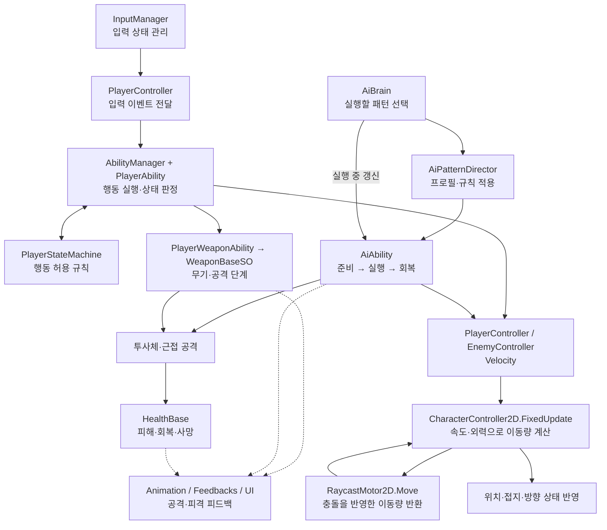
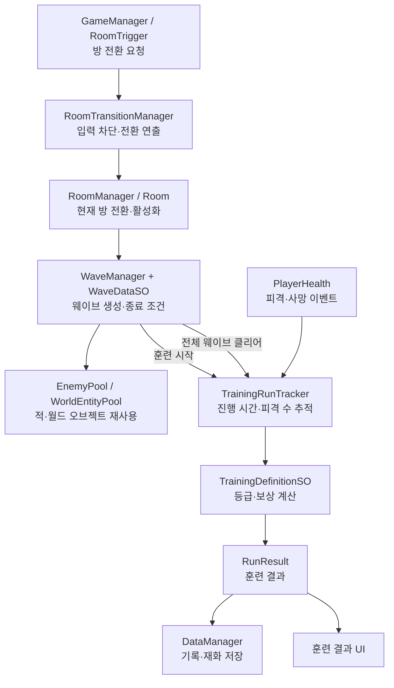

# 2D Combat Training Center · Scripts

Unity 기반 2D 전투 트레이닝 게임의 C# 코드입니다. 플레이어의 이동·전투, 적 패턴 선택, 웨이브 진행과 훈련 결과 평가를 중심으로 구성되어 있습니다.

## 프로젝트 소개와 상세 설계

[Notion에서 프로젝트와 설계 문서 읽기](https://capable-shade-0e8.notion.site/2D-Combat-Training-Center-401f11a67c9c81659388e84c5944d0a3)

게임 소개, 시스템별 동작 흐름과 설계 관점, **전체 C# 182개의 역할·연결 관계·공개 코드 링크**를 정리했습니다. 특정 클래스는 Notion의 **전체 스크립트 찾아보기**에서 찾을 수 있습니다. 아래 구조도로 전체 흐름을 먼저 파악한 뒤 관심 있는 시스템을 자세히 읽을 수 있습니다.

## 전체 논리 구조

화살표는 주요 데이터 흐름과 호출 관계를 나타냅니다.

플레이어는 입력 이벤트를 Ability에 전달하고, `AbilityManager`가 현재 행동을 정리합니다. 각 Ability는 `PlayerStateMachine.CanPerform`을 통해 행동 가능 여부를 확인합니다. 적은 `AiBrain`이 실행 가능한 후보를 선택하고, `AiPatternDirector`가 프로필과 규칙을 적용합니다. 강제 지정한 적 행동은 후보 선택 경로를 건너뜁니다.

플레이어와 적의 일반적인 속도 기반 이동은 `CharacterController2D`의 공통 경로를 사용합니다. `RaycastMotor2D`가 충돌을 계산한 이동량을 반환하면 컨트롤러가 위치와 충돌 상태를 반영합니다.

## 훈련 진행과 결과 처리

`WaveManager`가 훈련 시작과 웨이브 완료를 알리고, `TrainingRunTracker`가 피격·사망 이벤트와 진행 시간을 기록합니다. 클리어 여부에 따라 등급과 보상을 정한 뒤 `DataManager`에 결과를 반영합니다. 방 전환과 재도전은 별도의 전환 요청·연출 구조를 사용합니다.

## 코드 탐색

| 관심 영역 | 시작할 코드 | 살펴볼 내용 |
| --- | --- | --- |
| 캐릭터 이동 | [CharacterController2D](Scripts/Controllers/CharacterController2D.cs), [RaycastMotor2D](Scripts/Controllers/RaycastMotor2D.cs) | 속도·외력·고정 시간 간격의 이동, 충돌 결과 처리 |
| 입력과 행동 | [PlayerController](Scripts/Controllers/PlayerController.cs), [AbilityManager](Scripts/Abilities/Player/AbilityManager.cs), [PlayerStateMachine](Scripts/Abilities/Player/PlayerStateMachine.cs) | 입력 이벤트, 행동 우선순위, 상태별 실행 제한 |
| 무기와 전투 | [PlayerWeaponAbility](Scripts/Abilities/Player/PlayerWeaponAbility.cs), [WeaponBaseSO](Scripts/Weapons/Definitions/WeaponBaseSO.cs), [Weapons](Scripts/Weapons/Definitions) | 무기 선택, 공격 단계, 콤보·카운터·투사체 |
| 적 행동 | [AiBrain](Scripts/Abilities/Enemies/Core/AiBrain.cs), [AiPatternDirector](Scripts/Abilities/Enemies/Core/AiPatternDirector.cs), [AiAbility](Scripts/Abilities/Enemies/Core/AiAbility.cs) | 행동 선택과 패턴 실행의 분리, 프로필·규칙·단계별 처리 |
| 웨이브 | [WaveManager](Scripts/Waves/WaveManager.cs), [WaveDataSO](Scripts/Waves/Data/WaveDataSO.cs), [Wave](Scripts/Waves) | 스폰 데이터, 클리어 조건, 풀링 |
| 훈련 평가·저장 | [TrainingRunTracker](Scripts/Training/TrainingRunTracker.cs), [TrainingDefinitionSO](Scripts/Training/TrainingDefinitionSO.cs), [DataManager](Scripts/Persistence/DataManager.cs) | 결과 수집, 등급·보상, JSON 저장 |
| 방 전환 | [RoomTransitionManager](Scripts/Rooms/RoomTransitionManager.cs), [Rooms](Scripts/Rooms) | 전환 요청, 컨텍스트와 연출 분리 |
| 표현 | [Feedbacks](Scripts/Feedbacks), [Animation](Scripts/Animation), [UI](Scripts/UI) | 사운드·카메라·화면 효과와 상태 표시 |

## 구성과 의존성

`Scripts/`는 게임 코드의 폴더 구성을 유지합니다. `Input/Generated/PlayerInputActions.cs`는 프로젝트 입력 설정에서 Unity Input System이 생성한 코드입니다.

기준 환경은 **Unity 6000.2.9f1**이며, Input System, Cinemachine, Universal Render Pipeline, DOTween, TextMesh Pro 등 Unity 프로젝트의 의존성을 참조합니다. 이 저장소는 코드 열람용으로, 실행에 필요한 씬·프리팹·ScriptableObject 인스턴스·외부 플러그인과 에셋은 포함하지 않습니다.

이동·충돌 구현의 참고 출처는 [RaycastMotor2D.cs](Scripts/Controllers/RaycastMotor2D.cs)의 주석에 기록되어 있습니다.
